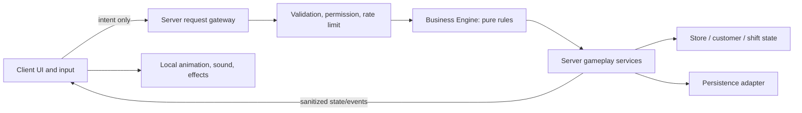

# Technical architecture (proposed)

## Boundaries

## Authority and modules
- **Client:** input, contextual UI, camera, animations and non-authoritative effects. It requests actions and renders server-confirmed outcomes.
- **Server request gateway:** narrow RemoteEvent/RemoteFunction entry points; payload schema, size, rate, ownership, permission, range and state checks; no arbitrary client-selected object paths or prices.
- **Business Engine:** pure Luau domain rules for catalog, stock, checkout math, upgrade eligibility/cost, shift results and event state transitions. No Roblox service access or persistence side effects; deterministic functions are unit-testable.
- **Gameplay services:** server-owned orchestration for store, inventory, customers, checkout, shift, chaos, upgrades and permissions. Services call domain functions and emit state changes.
- **Persistence adapter:** versioned schema, migration, session/write coordination, retries and recovery; never let stale saves overwrite newer state. Roblox DataStore specifics and budgets need Studio/platform verification before implementation.
- **Content/config:** server-validated product catalog, upgrade definitions, event definitions, UI copy, and buildable layout definitions. Client may receive only safe display data.

## Initial proposed layout
`src/ServerScriptService/` server bootstrap and services; `src/ReplicatedStorage/Shared/` shared types/catalog/domain-safe definitions; `src/StarterPlayer/StarterPlayerScripts/` client controllers; `src/StarterGui/` interface; `default.project.json` Rojo mapping; `docs/` product, design, architecture, security, operations. Mapping is a foundation only; Studio sync and runtime are unverified.

## Business Engine boundaries
Expose pure functions for validate/price/compute transitions and return explicit success or typed failure results. Accept normalized domain records, not raw remotes or Instances. The server resolves player, store and object ownership before calling rules. Keep rendering, pathfinding, DataStore access, analytics transport and Marketplace calls outside the engine.

## Persistence/economy invariants
Currency and stock changes occur only after server-side validation. Transactions have stable IDs and idempotent application. A receipt or saved operation cannot be granted twice. Schema has version and migration path. Session coordination and conflict strategy must be tested against actual DataStore semantics before release.

## Open technical decisions
See `docs/decisions/README.md`: collaboration/store ownership model; persistence/session strategy; Rojo project schema and CI runner availability; Studio place configuration; analytics implementation/privacy review. Avoid choosing APIs based on memory; verify current official Roblox documentation when implementation starts.
