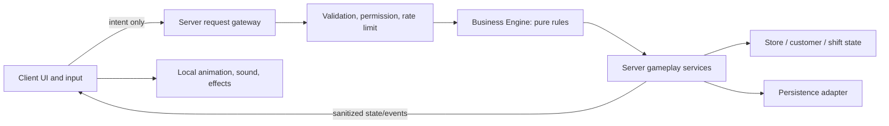

# Technical architecture (proposed)

## Boundaries

## Authority and modules
- **Client:** input, contextual UI, camera, animations and non-authoritative effects. It requests actions and renders server-confirmed outcomes.
- **Server request gateway:** narrow RemoteEvent/RemoteFunction entry points; payload schema, size, rate, ownership, permission, range and state checks; no arbitrary client-selected object paths or prices.
- **Business Engine:** pure Luau domain rules for catalog, stock, checkout math, upgrade eligibility/cost, shift results and event state transitions. No Roblox service access or persistence side effects; deterministic functions are unit-testable.
- **Gameplay services:** server-owned orchestration for store, inventory, customers, checkout, shift, chaos, upgrades and permissions. Services call domain functions and emit state changes.
- **Persistence adapter:** versioned schema, migration, session/write coordination, retries and recovery; never let stale saves overwrite newer state. `ProfileService` serializes writes per player across gameplay commits, autosave and release. Roblox DataStore specifics and budgets still need Studio/platform verification.
- **Content/config:** server-validated product catalog, upgrade definitions, event definitions, UI copy, and buildable layout definitions. Client may receive only safe display data.

## Initial proposed layout
`src/ServerScriptService/` server bootstrap and services; `src/ReplicatedStorage/Shared/` shared types/catalog/domain-safe definitions; `src/StarterPlayer/StarterPlayerScripts/` client controllers; `src/StarterGui/` interface; `default.project.json` Rojo mapping; `docs/` product, design, architecture, security, operations. Mapping is a foundation only; Studio sync and runtime are unverified.

## Business Engine boundaries
Expose pure functions for validate/price/compute transitions and return explicit success or typed failure results. Accept normalized domain records, not raw remotes or Instances. The server resolves player, store and object ownership before calling rules. Keep rendering, pathfinding, DataStore access, analytics transport and Marketplace calls outside the engine.

## Persistence/economy invariants
Currency and stock changes occur only after server-side validation. Transactions have stable IDs and idempotent application. A receipt or saved operation cannot be granted twice. Schema has version and migration path. Session coordination and conflict strategy must be tested against actual DataStore semantics before release.

## Phase 2 profile implementation
- `ProfileService` owns server-only DataStore access. The client receives only a sanitized shift snapshot and a save-status label.
- Each profile is keyed by `Player.UserId`, stores an explicit schema version, balance, current shift, owned upgrades and progression counters, and is normalized before use.
- An atomic `UpdateAsync` claim writes a unique server lease with expiry. Saves and lease refreshes verify the lease; autosave, PlayerRemoving and BindToClose attempt final writes/releases.
- A per-profile save guard ensures only one `UpdateAsync` save is in flight for the same profile; later gameplay/autosave/release saves wait and recheck the profile's current lease state.
- Store interactions are rejected for visitors and while the owner's profile is loading or its lease is known lost. One server has one store owner until the Phase 3 guest/role model.
- DataStore failures fall back to a fresh session-only profile; that profile is never written over the persistent record. The HUD exposes this state.
- G2 remains pending actual Studio testing, including two-server lock contention and failure recovery. This custom lease is a first implementation and is not yet a security certification.

## Phase 7 warehouse delivery and Phase 9–10 operations increments
- Profile schema v5 stores warehouse Citrus Pop backstock, pending shipment quantity and a Unix ready timestamp. Schemas v1–v4 receive 12 initial backstock cans; malformed or out-of-bound quantities/timestamps reject the profile rather than being silently trusted. Schema v5 adds `Spill` to the bounded shift-stage allowlist without introducing client-provided event data.
- `Economy.orderDelivery` owns the $60 transaction, 24-can shipment size, single-pending-order rule and 500-can backstock cap. `Economy.receiveDelivery` applies a due shipment once, then clears its pending fields.
- `ShiftService` authorizes both delivery prompts through Owner/Manager roles, server-side proximity and the common interaction rate limit. The shipment timer is reconstructed from the saved timestamp after a rejoin.
- Delivery presentation is created by `WorldBuilder`; the client receives only sanitized counters for store members. Developer commerce and Robux are not involved.
- `Economy.sellProduct` activates a bounded checkout-spill event after the first shift sale. `Economy.cleanSpill` pays the fixed $5 reward once and restores `Checkout`; server role, stage, range and rate checks gate the physical prompt. If a player leaves during the event, the persisted `Spill` stage reconstructs the objective. There is no event timer or destructive failure path.
- `WorldBuilder` presents at most three customers on a fixed, server-scripted enter/browse/queue/exit route. Shift sales reconstruct how many remain; a 12-second route fallback moves them to safe checkout positions. Customer models never grant currency; only the existing server sale transaction does.
- Profile schema v6 adds a validated `cleaner` employee boolean. Schemas v1–v5 default to no Cleaner; hiring takes the server-defined $120 once. A five-second server timer rechecks owner, save lock, employee flag and `Spill` stage before using the shared cleanup transition.

## Phase 7 multi-product increment
- Profile schema v7 persists Berry Bites shelf and backroom counters plus a product ID for the single pending warehouse shipment. Prior profiles normalize to zero shelf stock and 12 Berry Bites backstock if they already own the warehouse; legacy untagged shipments migrate as Citrus Pop.
- `Economy.PRODUCTS` defines server-owned Citrus Pop (`$25` sale, `$60`/24-can shipment), Berry Bites (`$18` sale, `$45`/24-pack shipment), Golden Apples and Sunrise Cereal. Product stock shares the per-SKU backroom cap and one-pending-shipment rule; each SKU retains its own price, shipment size, and restock limit.
- Checkout chooses the next SKU from server shift progress and available shelf stock, and the customer route/shelf visuals follow that choice. No client product/price argument is accepted.
- Owner/Manager can order either SKU; Owner/Manager/Stocker can stock Berry Bites. Existing prompt checks still enforce owner profile readiness, membership, role, distance and cooldown. See `operations/PHASE11_PRODUCTS.md` for acceptance and Studio verification.

## Phase 4 Power Outage increment
- Profile schema v8 persists the `PowerOutage` shift stage and a bounded Unix recovery timestamp. The normalizer accepts this pair only when the stage is active and a timestamp is present; older profiles default to no outage.
- The second server-priced sale starts a 30-second outage. Manual restoration at the checkout breaker returns to `Checkout` immediately; a server timer restores the queue after the deadline if nobody responds. Neither path adds a separate reward or sale.
- Owner/Manager/Maintenance may restore power, with the common prompt range, role, profile lease and rate checks. Cashier automation is paused by the stage and restarts on recovery. `WorldBuilder` owns only presentation: lighting, breaker sign and prompt.
- See `operations/PHASE12_POWER_OUTAGE.md`; Studio timer, persistence, role and visual behavior remain unverified.

## Phase 4 Customer Rush increment
- Profile schema v9 persists a `customerRushUntil` timestamp with the `CustomerRush` stage. Earlier schema versions default to no active rush; inconsistent stage/deadline pairs reject the profile.
- Completing the three normal sales starts a 60-second rush with two additional shoppers only when two shelf units remain. All rush sales use `Economy.sellProduct` and the existing product catalog. Clearing both pays one `$20` reward and proceeds to closeout; timeout drops only the unserved bonus queue and offers normal closeout without the reward. Insufficient stock proceeds to ordinary closeout without a rush.
- Customer models are bounded to five and reconstructed from saved sales/deadline. Cashier automation is allowed during the rush but the economy checks its deadline. `ShiftService` expires it only after checking the owner and save lock.
- See `operations/PHASE13_CUSTOMER_RUSH.md`; Studio queue, payout, timeout, automation and persistence checks remain pending.

## Phase 4 customer basket increment
- `Economy.getNextCheckoutBasket` derives a bounded basket pattern from the next server-owned customer number and resolves it against current shelf quantities for all catalog SKUs. It returns item names, quantities and catalog prices for display; `sellProduct` recomputes the basket and applies all deductions and credits as one customer transaction.
- Each basket increments `sales` once, so customer queues and chaos thresholds remain customer-based. If a preferred SKU is unavailable, its item is omitted; when no preferred item can be supplied, one stocked SKU is used. Empty shelves reject checkout without mutation.
- The next intent is reconstructed from the persisted sales count and current saved inventory. Profile schema v9 does not change. The world route and HUD only display the server decision and cannot control it.
- See `operations/PHASE14_CUSTOMER_BASKETS.md`; runtime pricing, stock, routing and rejoin checks remain pending.

## Phase 2 storefront customization increment
- `Economy.buyMarketStyle` checks the completed-shift state, existing ownership and fixed `$180` cost. `ShiftService` enforces Owner/Manager authorization, prompt distance, save readiness and interaction rate before calling the domain transition.
- Profile schema v10 persists `ownedUpgrades.marketStyle`; older schemas normalize to false. `WorldBuilder` changes a fixed set of fascia, sign, canopy and header colors and disables its purchase prompt after ownership. The palette is reapplied on profile load and is independent of shift restart.
- See `operations/PHASE15_STOREFRONT_STYLE.md`; Studio purchase, appearance, migration and rejoin checks remain pending.

## Phase 4 customer event reaction increment
- `WorldBuilder.setStage` changes visible queue labels for `Spill`, `PowerOutage` and `CustomerRush`. Customer route completion and queue recovery consult the same stage-derived label helper.
- Reactions are client-visible world presentation driven by server state. They do not alter `Economy`, persistence, deadlines or interaction permissions and add no remotes or profile fields.
- See `operations/PHASE16_CUSTOMER_EVENT_REACTIONS.md`; Studio appearance and route recovery checks remain pending.

## Phase 7 produce SKU increment
- Golden Apples use the existing product catalog, product-ID shipment, basket transaction, warehouse ownership and remote/prompt security boundaries. Order/receive/stock/sale transitions remain in the pure economy module; services orchestrate presentation, persistence and server authorization.
- Profile schema v11 persists `shift.goldenAppleStock`, `warehouseInventory.goldenApples`, and the already-generic shipment product ID. Legacy warehouse profiles with no apple field receive six backstock apples; no-warehouse profiles receive zero. Existing Citrus/Berry values and pending shipments normalize unchanged.
- The physical produce shelf and HUD are projections of authoritative counts. Customer baskets derive apple intent from customer number and use current stock; they require no saved order field.
- See `operations/PHASE17_GOLDEN_APPLES.md`; Studio migration, sale and shipment verification remain pending.

## Phase 4 employee automation controls
- `Economy` allow-lists cashier, stocker and cleaner automation changes and rejects toggles unless the selected employee is hired. Separate fixed board prompts are Owner/Manager-only through the existing ShiftService authorization gate.
- Profile schema v12 stores the three boolean settings. Missing values in v1–v11 profiles normalize to enabled, preserving earlier automation behavior.
- Each delayed automation uses a generation token and rechecks hire state, the saved automation flag, current stage, owner readiness and profile lease. Toggling off invalidates pending work; each eventual action still goes through the existing economy transition.
- Board prompt text and employee visibility are presentation only. See `operations/PHASE18_EMPLOYEE_AUTOMATION.md`; Studio behavior and migration checks remain pending.

## Phase 2 storefront preview
- Coastal Market preview is transient server state. Owner/Manager can apply or cancel the fixed palette at a separate prompt; leaving the completed-shift state resets an unpurchased preview.
- Purchase remains the existing server economy transaction and profile v10 ownership flag. No preview preference or schema migration is saved. The shared physical store means all current server players see the preview. See `operations/PHASE19_STOREFRONT_PREVIEW.md`; Studio verification remains pending.

## Phase 4 delivery worker
- The worker is gated on warehouse ownership and a completed shift. Its Owner/Manager automation toggle is saved with the other employees in profile schema v13.
- A delayed pickup is keyed to the current shipment ready timestamp and generation token; it rechecks hire, automation, owner/session and save-lock state before using `Economy.receiveDelivery`. Manual receipt and auto-receipt converge on that same transaction.
- The shipment remains singular and SKU-specific. See `operations/PHASE20_DELIVERY_WORKER.md`; Studio timer, race and migration checks remain pending.

## Phase 7 Sunrise Cereal SKU
- Sunrise Cereal uses the existing catalog-driven order, receipt, basket and checkout paths. Shelf stock and backstock are separate server-owned quantities; restocking moves three boxes, each worth `$16`, with an 18-box `$45` shipment.
- Profile schema v14 validates cereal counters and warehouse ownership, adds the SKU to the single pending shipment allow-list, and migrates older warehouse profiles with six boxes when absent. The delivery worker and manual dock use the same receipt transaction.
- The pantry shelf, customer route, order label and four-SKU HUD reflect current server state only. See `operations/PHASE21_SUNRISE_CEREAL.md`; Studio acceptance remains pending.

## Phase 2 product pricing
- The owner or Manager cycles each shelf through three fixed prices derived from its catalog base. Shelf tags and the next basket total reflect the saved server state.
- Profile schema v15 allow-lists four product IDs and their exact integer price options; schemas v1–v14 default to catalog prices. Checkout recomputes each unit price before applying an atomic basket sale.
- See `operations/PHASE22_PRODUCT_PRICING.md`; demand response and Studio checks remain pending.

## Phase 4 price-sensitive customer baskets
- Basket intent is reconstructed from server shift sales. A discounted single-product basket adds one unit only when shelf stock permits; a premium multi-unit request removes one. Mixed and base-price baskets keep their intent quantities.
- Basket labels and totals are projections; checkout recomputes the same bounded quantities and price and commits one atomic sale. No new persistence fields or random demand state are introduced.
- See `operations/PHASE23_PRICE_SENSITIVE_BASKETS.md`; customer behavior and recovery checks remain pending in Studio.

## Phase 4 stocker replenishment
- The stock clerk handles the introductory Citrus Pop action and later checks the next server-owned basket intent. It restocks at most one empty preferred SKU when a full batch exists in backstock, using the same bounded economy transitions as player prompts.
- Citrus Pop can be restocked in Checkout or Customer Rush and uses a 24-can shelf cap. Profile schema remains v15; malformed/out-of-bound saved shelf stock is rejected.
- See `operations/PHASE24_STOCKER_REPLENISHMENT.md`; timers, stock races and rejoin recovery remain pending in Studio.

## Phase 4 Customer Assistant
- Hiring is an Owner/Manager-only server transaction after a completed shift. Profile schema v16 persists the employee; older profiles default to not hired.
- The visible assistant shortens only the procedural browse route. Basket intent, inventory, checkout readiness and sale math remain unchanged and server-owned.
- See `operations/PHASE25_CUSTOMER_ASSISTANT.md`; route timing and persistence checks remain pending in Studio.

## Phase 5 repeat-shift analytics
- `TelemetryService` records first-shift completion, another shift start and repeat completion using server-confirmed commits. Returning profiles start at the profile-loaded step.
- Funnel UUIDs and successful-step counters are ephemeral. Events remain gated to development universe `10770581249`; API failures do not affect gameplay or profile saving.
- See `operations/PHASE26_REPEAT_SHIFT_ANALYTICS.md`; dashboard ingestion remains pending.

## Phase 7 fixed-slot department expansion
- `Economy.buyAisleExpansion` accepts only a completed shift, existing first shelf bay, sufficient server cash and no prior expansion; the cost is fixed at `$220`.
- Profile schema v17 persists one allow-listed `ownedUpgrades.aisleExpansion` flag and rejects malformed or prerequisite-free records. Older profiles default to no expansion.
- `ShiftService` authorizes Owner/Manager through its shared prompt gate; `WorldBuilder` creates the fixture in one fixed, reviewed slot and reconstructs it on profile load. Arbitrary placement and rotation are future work.
- See `operations/PHASE27_HOUSEHOLD_AISLE_EXPANSION.md`; Studio purchase, multiplayer and save/rejoin checks remain pending.

## Phase 63 movable expansion departments
- Retail layout v3 adds compact placements for the bakery and freezer. Older v1/v2 layouts normalize to fixed starter coordinates.
- Owner/Manager layout edits remain gated by completed shift, purchase ownership, proximity, request bounds and collision validation. Server-built fixture models carry prompts, price tags, signs and stocked visuals when moved/rotated.
- Customer browse targets are recalculated from the saved product fixture position. Unknown IDs, arbitrary instances, invalid grid coordinates and cross-location requests are rejected.
- See `operations/PHASE63_EXPANSION_DEPARTMENT_LAYOUT.md`; Studio movement, routing, migration, permissions and mobile checks remain pending.

## Phase 64 purchased retail fixtures

- Retail layout v4 stores transforms for the owned extra shelf bay and household aisle. Profile schema is unchanged and older retail layouts receive default fixture records.
- The server validates purchase ownership and placement against merchandise shelves, checkout queue, rear departments and the other purchased fixture before pivoting the existing world model.
- See `operations/PHASE64_MOVABLE_CORE_FIXTURES.md`; Studio movement, migration, multiplayer and touch checks remain pending.

## Phase 4 employee payroll
- `Economy.getShiftPayroll` totals fixed wages from server-owned employee hire flags. Automation pause state does not alter employment.
- `Economy.closeShift` credits the existing shift bonus and deducts the computed wages exactly once after validating the closeout stage/flag. Existing profile serialization persists only the resulting balance; schema v17 is unchanged.
- `ShiftService` exposes a computed per-shift estimate only to store members; the existing HUD status line displays it without an additional panel.
- See `operations/PHASE28_SHIFT_PAYROLL.md`; Studio transaction and save/rejoin checks remain pending.

## Phase 7 warehouse layout editor
- `LayoutService` owns pure validation for version-1 records, a bounded two-stud warehouse grid, a six-shelf cap, 0/90-degree orientations, fixture overlap and the fixed layout-board clearance.
- Owner/Manager opens the editor from a physical warehouse prompt. The client previews and proposes edits, while `ShiftService` rechecks membership, stage, warehouse ownership, profile lock, proximity, rate, action ID and payload before creating/moving/removing a shelf.
- Placement/removal cash changes and compact layout records persist via the existing serialized profile path. Schema v18 migrates old profiles to an empty layout; `WorldBuilder` rebuilds from validated records.
- See `operations/PHASE29_WAREHOUSE_LAYOUT_EDITOR.md`; client preview, Studio authorization, collision and DataStore recovery checks remain pending.
- Phase 39 stores one of three server-allow-listed storefront palette IDs beside the existing style purchase. Preview/cancel state remains in server memory; the purchase persists in profile schema v24. Legacy `marketStyle=true` profiles without an ID migrate to Coastal Market. See `operations/PHASE39_STOREFRONT_PALETTE_CHOICES.md`; Studio appearance and migration checks remain pending.
- Phase 40 adds Freezer Meals after the rear wing, warehouse and bakery. Schema v25 stores freezer ownership, shelf/backroom counts and a bounded price. Existing `Economy` flows handle SKU deliveries, restock, customer selection, substitution, checkout and stocker automation; `RetailLayoutService` rejects conflicting retail shelves. Stock and price prompts exist before the department is bought, then reparent onto the server-built fixture to retain their existing event connections. See `operations/PHASE40_FREEZER_DEPARTMENT.md`; Studio route, collision and migration verification remains pending.
- Phase 41 animates the entrance glass panels from a server-created touch sensor and explicit scripted-customer route hooks. Tween targets are fixed, the close timer is generation-guarded, and glass is non-collidable so animation cannot block traffic. No remote, profile field or economy transition is involved; see `operations/PHASE41_AUTOMATIC_ENTRANCE_DOORS.md`.
- Phase 42 applies the existing per-player layout cooldown before parsing warehouse/retail payloads, drops requests during cooldown without a response, and accepts only action-specific top-level key sets of at most five fields. Coordinate, role, range, collision and save checks still control all mutations; see `operations/PHASE42_LAYOUT_REMOTE_HARDENING.md`.
- Phase 43 adds a persistent self-checkout terminal to the movable checkout fixture. Profile schema v26 requires rear-wing and warehouse ownership. Server customer indexes select one lane, queue routes and front-of-line prompts follow that lane, and both prompt callbacks invoke the same `Economy.sellProduct` transaction. A server sale lock spans persistence and route refresh so helpers/cashier cannot race one customer twice. The cashier employee can serve either lane; see `operations/PHASE43_SELF_CHECKOUT.md`.
- Customer basket preferences use a deterministic weighted draw from completed-shift count and sale number. Only server logic reads stock/prices to fulfill the preference; billboards receive display strings. See `operations/PHASE30_CUSTOMER_PREFERENCES.md`.
- Chaos event order is derived from the server-known owner ID and completed-shift count. Rejoin reconstructs the same plan without persisting a client-controlled seed; active stages and outage deadlines continue through profile persistence. See `operations/PHASE31_CHAOS_DIRECTOR.md`.
- Profile schema v19 stores a validated layout for the four retail SKU shelves. Server movement updates shelf prompts/tags and the customer browse route together; the client only previews and proposes grid positions. See `operations/PHASE32_RETAIL_LAYOUT.md`.
- Profile schema v20 stores a bounded customer satisfaction score. The server updates it in the successful sale transaction from preferred quantity fulfillment and premium SKU pricing; authorized HUDs only display the value. See `operations/PHASE33_CUSTOMER_SATISFACTION.md`.

## Open technical decisions
See `docs/decisions/README.md` for accepted ownership policy. Remaining decisions include multi-store/guest permissions, production Studio place configuration, analytics implementation/privacy review, and any changes to persistence recovery. Verify platform APIs against official documentation when implementation starts.

## Phase 44 online grocery packing
- `Economy.getNextOnlineOrder` derives a bounded four-order rotation from the saved fulfilled-order count. The server selects item IDs and quantities, reads current server prices, and checks warehouse backstock; clients supply no basket, price or quantity.
- `Economy.fulfillOnlineOrder` is a single between-shifts transaction. It rechecks warehouse ownership, stage and all stock before deducting units and crediting the computed total. Manager and Stocker prompts share the normal proximity, rate, owner and profile-save gates, plus the transaction lock.
- Profile schema v27 persists only the bounded fulfilled-order counter; orders are regenerated from that counter on load. Warehouse board text contains display-only item names, amounts and readiness.

## Phase 45 delivery worker online order automation
- The existing delivery worker now checks both ready inbound shipments and the next online grocery order. Online packing is eligible only after a completed shift and only once per `completedShifts` value.
- The worker uses the existing automation toggle. A saved shift marker prevents rejoin or scheduler retries from packing a second automatic order during the same completed shift.
- The worker delegates to `Economy.fulfillOnlineOrder`, the same state transition as the physical packing prompt. Both paths share the transaction lock through profile save and schedule refresh.
- Profile schema v28 migrates the marker to zero for older profiles; automation remains disabled for non-development DataStore universes as before.

## Phase 46 larger Customer Rush
- Customer Rush remains triggered by the deterministic shift logic after the three regular sales, but now adds three customers (six total), allows 90 seconds, and pays `$30` only on a timely clear.
- `WorldBuilder` provisions six bounded customer models and six main queue positions; the self-checkout split gives three positions to each lane. Recovery reconstructs these positions from persisted sales and deadline state.
- Profile normalization accepts up to six sales and the expanded in-progress rush range. This widens validation only; no profile schema field or migration is needed.

## Phase 47 Corner Café plaza business
- `Economy.buyCafe`, `restockCafe` and `serveCafeCoffee` own the fixed `$650` purchase, `$45` six-unit batch, 24-cup cap and `$18` per-cup revenue. Café sales do not alter supermarket customer queue counts or grocery inventory.
- `ShiftService` gates purchase/restock/serve prompts by Owner/Manager, Stocker or Cashier role, range, interaction rate, profile lease and the shared transaction lock. Purchase/restock require a completed shift; serving is available whenever the profile is ready and stock remains.
- `WorldBuilder` creates the fixed café building and board from built-in Roblox parts. The menu board and cup visuals are presentation only and follow the saved server state.
- Profile schema v29 persists café ownership plus coffee stock and sale count. Old profiles migrate to unowned/empty; invalid ownership without a warehouse, inventory above 24 or stock/sales without ownership are rejected.

## Phase 48 Market Table restaurant
- `Economy.buyRestaurant`, `restockRestaurant` and `serveRestaurantMeal` own the `$1,200` purchase, `$80` batch of four, 16-meal capacity and `$38` sale price. Restaurant sales share cash but do not increment grocery-shift customers or sales.
- The restaurant is gated behind the café, which already implies warehouse ownership. The same role/range/rate/profile-lock checks and shared transaction lock protect build, prep and service.
- `WorldBuilder` renders the fixed dining building, awning, menu, tables, chef, warmer and meal visuals from built-in parts. `ProfileService` schema v30 validates restaurant ownership after café ownership, and meal stock/sales only when the restaurant exists.

## Phase 49 Pixel & Plug electronics store
- The electronics business follows the same owner profile and shared balance. It unlocks after the restaurant, costs `$2,400`, stocks two headphones for `$300` up to eight and sells each for `$220`.
- Owner/Manager build, Stocker restock and Cashier sale use the common prompt security and shared transaction lock. Store sales do not change supermarket shift progression.
- Profile schema v31 persists ownership, bounded stock and sales. Built-in parts render the plaza shop, product display, clerk and menu; no third-party assets are used.

## Phase 50 Little Sprout Garden specialty retailer
- The fixed garden storefront unlocks after Pixel & Plug, costs `$1,800`, stocks three potted herbs for `$120` up to 12 and sells each for `$75`.
- Owner/Manager build, Stocker restock and Cashier sale use the existing common prompt authorization and transaction lock. Garden sales share the owner balance but do not increment supermarket shift sales.
- Profile schema v32 persists store ownership, bounded stock and sales. The storefront, plant display and gardener use built-in Roblox parts and materials.

## Phase 51 plaza customization
- After the specialty retailer is owned, Owner/Manager can preview and install one of three allow-listed palette IDs for `$750` during a completed shift.
- `WorldBuilder` applies the selected palette to all four plaza storefronts and the connector paths. Preview state remains ephemeral and is reset on cancellation, install or leaving the completed-shift stage.
- Profile schema v33 persists only the selected palette ID. Clients cannot submit arbitrary colors or part references.

## Phase 52 shared plaza traffic
- `WorldBuilder` creates a fixed pool of four anchored procedural visitors and uses short server-side pivot interpolation between plaza path points and currently owned storefronts.
- Each visitor browses one open business and exits; the pool and route destinations are hard-bounded. World destruction ends each route loop.
- Route movement is visual-only; the separately versioned Phase 53 browse event uses the existing server economy transition for a purchase.

## Phase 53 plaza customer sales
- At a visitor's server-generated browse event, `ShiftService` accepts only one of four fixed business IDs and invokes that business's existing `Economy` sale transition.
- Owner readiness, profile lease/save state, per-business 15-second cooldown and the common transaction lock gate the sale. Existing profile stock/sales fields are saved through `commit`.
- Visitors cannot choose products, quantities or prices. Empty stock and dropped concurrent events do not pay; visitors retry on a later route.

## Phase 54 delivery fleet
- The persistent `$3,000` fleet upgrade requires warehouse ownership and a hired delivery worker; `WorldBuilder` builds two procedural trucks at the loading dock.
- Existing online-order automation uses the same deterministic rotation and stock/payout transition, now capped at three packed orders per completed shift when the fleet is owned. Manual orders consume capacity too.
- Profile schema v34 adds a 0–3 per-shift order count. Existing v33 profiles with a current-shift idempotency marker migrate with count 1; other profiles default to 0. The shared transaction lock and delivery-worker automation toggle remain authoritative.

## Phase 55 distribution center
- Owner/Manager can buy the one-time `$6,000` facility only after a completed shift and delivery-fleet ownership. `Economy` verifies prerequisites, funds and ownership; the prompt supplies no purchase values.
- Profile schema v35 persists ownership. Inventory normalization allows up to 1,000 units per SKU only when this saved upgrade exists; legacy profiles default to the existing 500-unit cap.
- Delivery ordering and receiving share the same server-derived capacity method, so a shipment cannot exceed the cap at either step. Existing shipment timing, cost, quantity, SKU and transaction lock remain unchanged.
- `WorldBuilder` constructs the facility from original anchored parts. Runtime visuals are not persisted; they are rebuilt from profile ownership on load.

## Phase 56 supplier partnership
- Owner/Manager can buy a one-time `$2,500` supplier contract after owning the regional distribution center. The existing inbound product catalog remains the source for all SKUs and quantities.
- `Economy.getDeliveryCost` applies a fixed 20% discount using integer server prices. Order authorization and the transaction lock remain unchanged; neither price nor contract ownership comes from client arguments.
- Profile schema v36 persists the partnership flag and requires the distribution center. Legacy profiles migrate to no contract. Warehouse order prompts show the same discounted costs that the server charges.

## Phases 57–62 multi-store runtime
- One player profile and DataStore lease own a shared company balance plus separate `neighborhood` and optional `uptown` location snapshots. Schema v39 validates the fixed location IDs and keeps cash out of the snapshots.
- `BranchRuntimeService` clones an isolated `ShiftService` module for Uptown. Each runtime has its own world, shift/economy state, action cooldowns, and session membership table. Both obtain the same server-only wallet and save location state through the serialized `ProfileService` writer.
- The neighborhood runtime alone loads/releases the profile and coordinates autosave. Uptown opens only after the `$15,000` server-authorized purchase, after supplier partnership, between shifts. Server-controlled travel selects the active location; location selectors on shared layout/team remotes are validated and never grant access.
- Profile migration, Studio multiplayer behavior, branch save/rejoin, cross-location denial, and concurrent lease behavior remain manual verification gates. See ADR-0055–0059 and `operations/PHASE57_MULTI_STORE_FOUNDATION.md` / `operations/PHASE62_UPTOWN_BRANCH_RUNTIME.md`.

## Phase 58 commercial neighborhood buildout
- The neighborhood ground now covers the plaza extent, and a delivery avenue meets the main road at a marked pedestrian crossing. Five original streetlights and two glass-front decorative shop shells fill the commercial block.
- Maple Corner Florist and Riverside Bookshop are server-owned businesses stored on the existing neighborhood location profile. The bookshop is unlocked after the florist and uses bounded paperback stock, server-priced sales and the existing plaza visitor transaction path. These businesses are not separate store locations or branch runtimes.
- All scenery is generated from Roblox parts/materials, is contained in the location model and moves with its server-approved origin.

## Phase 59 Maple Corner Florist
- The persistent florist unlocks after Little Sprout Garden. Its server-priced purchase costs `$1,500`; each `$320` restock adds four bouquets up to 12, and a bouquet sale adds `$240` to the shared store balance.
- Owner/Manager can build, restock and sell; Stocker can restock; Cashier can sell. Visitor purchases call the same sale transition, require an available profile and stock, share the transaction lock, and use the existing 15-second business throttle.
- Profile schema v38 stores florist ownership, stock and sales. v37 migration supplies false/zero defaults and validates the old `locations.neighborhood` snapshot with those newly added fields omitted. Existing profile values remain the source of truth.
- See ADR-0056 and `operations/PHASE59_MAPLE_CORNER_FLORIST.md`. Multi-store runtime and Studio verification remain pending.

## Phase 69 Riverside Bookshop
- The bookshop unlocks after florist ownership for `$2,500`; three paperbacks cost `$300` to restock (12-item cap) and sell for `$130` each. Server-built bookcases, visible stocked books, a sign and counter prompts are presentation; the profile state remains authoritative.
- Owner/Manager build, Manager/Stocker restock, Manager/Cashier sell. Automated plaza purchases use the same bounded sale transition, 15-second per-business throttle and transaction lock as the florist.
- Profile schema v40 stores bookshop ownership, stock and sales in the existing neighborhood location. Version 39 profiles and location snapshots gain safe defaults; `RetailLayoutService` validates saved layout versions during migration.
- See ADR-0065 and `operations/PHASE69_RIVERSIDE_BOOKSHOP.md`; Studio visuals, roles, visitor sales, migration and save/rejoin remain pending.

## Phase 60 multi-location profile storage
- Profile schema v39 permits exactly `neighborhood` and one optional `uptown` location. Each stores an independently normalized operational snapshot; the shared company balance and session lease remain at profile root.
- `ProfileService.getLocation` returns a defensive copy for either existing location; `getCompanyBalance` reads the shared root balance. `createLocation` accepts only `uptown` and seeds a server-default snapshot; `saveProgress` accepts a known existing location and routes its snapshot update through the same serialized profile save.
- Profile loading validates the original neighborhood against legacy flat fields and validates `uptown` through the normal profile validators. Unknown IDs, malformed state and unsupported counts are rejected.
- This is only storage infrastructure. Shared wallet binding is added in Phase 61; branch purchase, branch runtime/world, switching and per-location memberships still need implementation before users can operate two stores.
- See ADR-0057 and `operations/PHASE60_LOCATION_PROFILE_STORAGE.md`.

## Phase 61 shared company wallet
- `ProfileService` creates one server-owned cash wallet per loaded owner profile. The neighborhood `Economy` state proxies its `cash` field to this table; future branch states must use the same reference.
- Profile mutation serialization spans location projection updates and the existing serialized DataStore save. Each save persists the wallet balance at the company root and keeps it out of location snapshots.
- No second runtime is connected yet. Per-location interaction locks remain necessary in addition to the shared profile mutation lock.
- See ADR-0058 and `operations/PHASE61_COMPANY_WALLET.md`.
- Phase 66 reuses the installed storefront palette ID for selected interior surfaces. WorldBuilder maps IDs to role-specific fixed colors; preview remains server-session-only and the owned palette stays in the location profile.
- No new client color data, profile fields, remotes or economy transitions are introduced. See ADR-0062 and operations/PHASE66_INTERIOR_STYLE_PALETTES.md.
- Phase 67 adds up to four GUID-keyed constructed aisle transforms to retail layout v5 in each owned location. `Economy` charges the fixed build cost, `RetailLayoutService` validates the grid and collisions, `WorldBuilder` builds the fixture, and `ProfileService` persists it under the existing owner lease. No profile schema change is needed.
- Phase 68 derives facility operating costs from the active server state and applies them in the existing guarded shift-close transition after payroll. Only the resulting cash persists; owned upgrades remain the source of truth, and no new profile field or client charge input is used.
- Phase 70 extends retail layout v5 to v6 by adding a server-allow-listed product ID to each constructed aisle. Legacy aisles without a department migrate to Citrus Pop. `WorldBuilder` divides each SKU's visible stock across the original shelf and assigned aisles; each inventory-backed display count sums to the existing server quantity. No SKU, stock transition or checkout behavior is added.
- Phase 71 derives each customer browse waypoint from the active basket, current stock allocation and saved retail transforms. When an assigned aisle has stock, customers browse its front; otherwise they use the primary product shelf. This changes presentation/navigation only, with no new persistence or economy state.

# Cooperative ownership and cashier extension
- One owner profile remains the persistence boundary. Per-server membership grants temporary action permissions but does not load a guest's profile into the owner's economy.
- Server role map: Owner (all), Manager (all shift actions including staff hiring), Cashier (checkout), Stocker (stock), Maintenance (cart recovery).
- Client-to-server membership remotes carry only an action, target UserId and allow-listed role. Server validates owner authority, current membership, capacity and rate limits.
- The Phase 4 cashier stores one boolean in profile schema v2. Its delayed checkout reuses `Economy.sellProduct`, so revenue and stock consume the same authoritative state transition as a player checkout.
- DataStore access is restricted to development universe `10770581249`; configuring a production ID is a future deployment task.
- `TelemetryService` emits the first-shift funnel through Roblox AnalyticsService only in the development universe. Roblox associates each event with the required Player argument. The game sends no custom fields or identifiers, stores the ephemeral funnel session ID only in server memory, and contains AnalyticsService errors so gameplay continues.
- Touch clients lay out the HUD around the viewport and start with the objective card collapsed at top center. The team panel stays a local presentation layer and closes independently of server membership.
