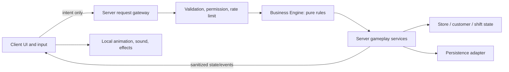

# Technical architecture (proposed)

## Boundaries

## Authority and modules
- **Client:** input, contextual UI, camera, animations and non-authoritative effects. It requests actions and renders server-confirmed outcomes.
- **Server request gateway:** narrow RemoteEvent/RemoteFunction entry points; payload schema, size, rate, ownership, permission, range and state checks; no arbitrary client-selected object paths or prices.
- **Business Engine:** pure Luau domain rules for catalog, stock, checkout math, upgrade eligibility/cost, shift results and event state transitions. No Roblox service access or persistence side effects; deterministic functions are unit-testable.
- **Gameplay services:** server-owned orchestration for store, inventory, customers, checkout, shift, chaos, upgrades and permissions. Services call domain functions and emit state changes.
- **Persistence adapter:** versioned schema, migration, session/write coordination, retries and recovery; never let stale saves overwrite newer state. `ProfileService` serializes writes per player across gameplay commits, autosave and release. Roblox DataStore specifics and budgets still need Studio/platform verification.
- **Content/config:** server-validated product catalog, upgrade definitions, event definitions, UI copy, and buildable layout definitions. Client may receive only safe display data.

## Initial proposed layout
`src/ServerScriptService/` server bootstrap and services; `src/ReplicatedStorage/Shared/` shared types/catalog/domain-safe definitions; `src/StarterPlayer/StarterPlayerScripts/` client controllers; `src/StarterGui/` interface; `default.project.json` Rojo mapping; `docs/` product, design, architecture, security, operations. Mapping is a foundation only; Studio sync and runtime are unverified.

## Business Engine boundaries
Expose pure functions for validate/price/compute transitions and return explicit success or typed failure results. Accept normalized domain records, not raw remotes or Instances. The server resolves player, store and object ownership before calling rules. Keep rendering, pathfinding, DataStore access, analytics transport and Marketplace calls outside the engine.

## Persistence/economy invariants
Currency and stock changes occur only after server-side validation. Transactions have stable IDs and idempotent application. A receipt or saved operation cannot be granted twice. Schema has version and migration path. Session coordination and conflict strategy must be tested against actual DataStore semantics before release.

## Phase 2 profile implementation
- `ProfileService` owns server-only DataStore access. The client receives only a sanitized shift snapshot and a save-status label.
- Each profile is keyed by `Player.UserId`, stores an explicit schema version, balance, current shift, owned upgrades and progression counters, and is normalized before use.
- An atomic `UpdateAsync` claim writes a unique server lease with expiry. Saves and lease refreshes verify the lease; autosave, PlayerRemoving and BindToClose attempt final writes/releases.
- A per-profile save guard ensures only one `UpdateAsync` save is in flight for the same profile; later gameplay/autosave/release saves wait and recheck the profile's current lease state.
- Store interactions are rejected for visitors and while the owner's profile is loading or its lease is known lost. One server has one store owner until the Phase 3 guest/role model.
- DataStore failures fall back to a fresh session-only profile; that profile is never written over the persistent record. The HUD exposes this state.
- G2 remains pending actual Studio testing, including two-server lock contention and failure recovery. This custom lease is a first implementation and is not yet a security certification.

## Phase 7 warehouse delivery and Phase 9 chaos increments
- Profile schema v5 stores warehouse Citrus Pop backstock, pending shipment quantity and a Unix ready timestamp. Schemas v1–v4 receive 12 initial backstock cans; malformed or out-of-bound quantities/timestamps reject the profile rather than being silently trusted. Schema v5 adds `Spill` to the bounded shift-stage allowlist without introducing client-provided event data.
- `Economy.orderDelivery` owns the $60 transaction, 24-can shipment size, single-pending-order rule and 500-can backstock cap. `Economy.receiveDelivery` applies a due shipment once, then clears its pending fields.
- `ShiftService` authorizes both delivery prompts through Owner/Manager roles, server-side proximity and the common interaction rate limit. The shipment timer is reconstructed from the saved timestamp after a rejoin.
- Delivery presentation is created by `WorldBuilder`; the client receives only sanitized counters for store members. Developer commerce and Robux are not involved.
- `Economy.sellProduct` activates a bounded checkout-spill event after the first shift sale. `Economy.cleanSpill` pays the fixed $5 reward once and restores `Checkout`; server role, stage, range and rate checks gate the physical prompt. If a player leaves during the event, the persisted `Spill` stage reconstructs the objective. There is no event timer or destructive failure path.

## Open technical decisions
See `docs/decisions/README.md` for accepted ownership policy. Remaining decisions include multi-store/guest permissions, production Studio place configuration, analytics implementation/privacy review, and any changes to persistence recovery. Verify platform APIs against official documentation when implementation starts.
# Cooperative ownership and cashier extension
- One owner profile remains the persistence boundary. Per-server membership grants temporary action permissions but does not load a guest's profile into the owner's economy.
- Server role map: Owner (all), Manager (all shift actions including staff hiring), Cashier (checkout), Stocker (stock), Maintenance (cart recovery).
- Client-to-server membership remotes carry only an action, target UserId and allow-listed role. Server validates owner authority, current membership, capacity and rate limits.
- The Phase 4 cashier stores one boolean in profile schema v2. Its delayed checkout reuses `Economy.sellProduct`, so revenue and stock consume the same authoritative state transition as a player checkout.
- DataStore access is restricted to development universe `10770581249`; configuring a production ID is a future deployment task.
- `TelemetryService` emits the first-shift funnel through Roblox AnalyticsService only in the development universe. Roblox associates each event with the required Player argument. The game sends no custom fields or identifiers, stores the ephemeral funnel session ID only in server memory, and contains AnalyticsService errors so gameplay continues.
- Touch clients lay out the HUD around the viewport and start with the objective card collapsed at top center. The team panel stays a local presentation layer and closes independently of server membership.
